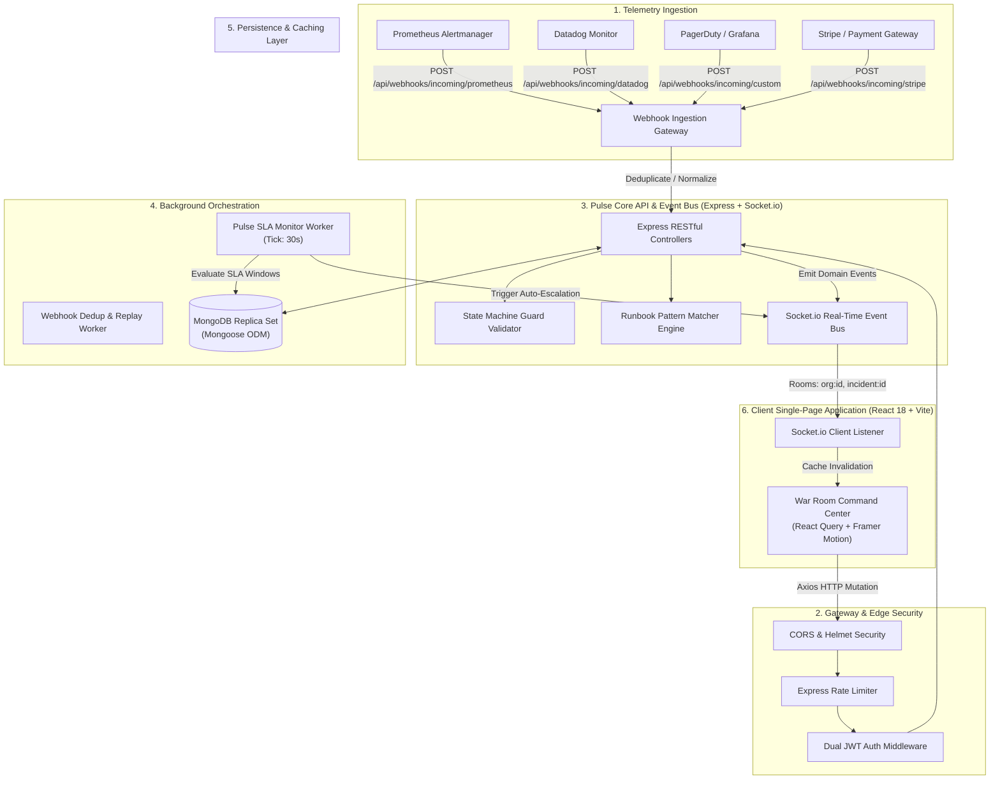
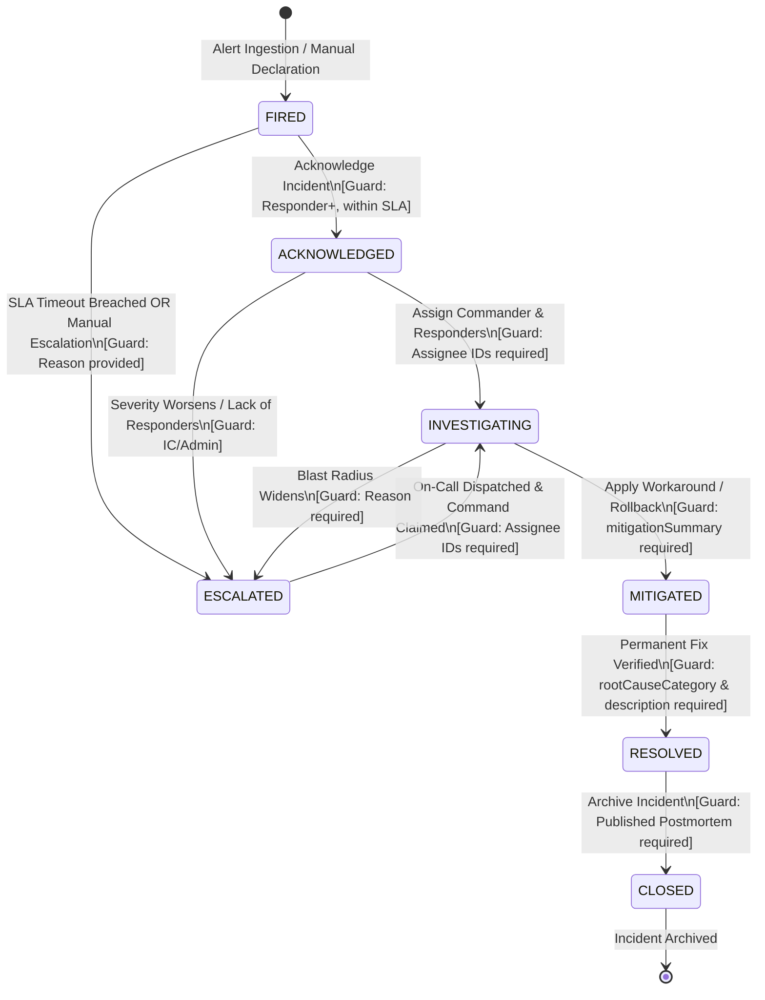
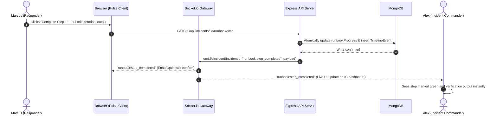

# Pulse — System Architecture & Technical Specifications

> **Automated Incident Triage & Response Engine**  
> *Production-grade distributed incident response platform with state machine enforcement, real-time Socket.io coordination, automated runbook matching, webhook deduplication, and SLA breach monitoring.*

---

## 1. System Overview

### 1.1 What is Pulse?
**Pulse** is a mission-critical incident triage and automated response engine built for modern Site Reliability Engineering (SRE), DevOps, and platform teams. When distributed systems degrade, engineering teams often suffer from alarm fatigue, disjointed communication channels, untracked remediation steps, and missed Service Level Agreements (SLAs). 

Pulse acts as an authoritative operational control plane. It unifies inbound telemetry from disparate monitoring systems (Prometheus, Datadog, PagerDuty, Grafana, Stripe, and custom edge webhooks), deduplicates alert storms into canonical incidents, matches intelligent Standard Operating Procedure (SOP) runbooks, orchestrates incident commander delegation, enforces rigorous state machine transitions, and powers blameless postmortem collaboration.

### 1.2 Target Personas & Use Cases
Pulse is engineered for multi-role platform engineering organizations:

| Persona | Role Key | Primary Responsibilities in Pulse |
| :--- | :--- | :--- |
| **Platform Administrator** | `ADMIN` | Manages organizational settings, configures SLA policies, invites team members, updates roles, audits webhooks, and authoritatively manages runbooks. |
| **Incident Commander** | `INCIDENT_COMMANDER` | Leads active war rooms, assigns responders, approves state transitions (Mitigated, Resolved), attaches runbooks, and publishes postmortems. |
| **On-Call Responder** | `RESPONDER` | Acknowledges fired alerts, executes and verifies runbook terminal commands, posts technical observations, and applies mitigation actions. |
| **Observer / Stakeholder** | `VIEWER` | Read-only visibility into the incident command feed, public status notes, postmortems, and aggregate SRE analytics dashboards. |

### 1.3 Core Engineering Tenets
1. **Zero-Ambiguity State Machine**: Incidents cannot bypass stages or transition without meeting cryptographically validated data guards.
2. **Sub-Second Real-Time Synchronization**: Every state shift, assignment, runbook verification, and timeline comment propagates instantaneously across all active browser sessions via WebSockets.
3. **Deterministic Alert Ingestion & Deduplication**: High-frequency monitoring flaps are hashed and collapsed into a single active incident within configurable time windows.
4. **Actionable Automation (Runbooks as Code)**: Dynamic SOP runbooks auto-attach based on semantic service matching, title keywords, and severity classifications.
5. **Auditable Lifecycle**: Every interaction produces an immutable, chronological audit trail for governance, compliance, and retrospective learning.

---

## 2. High-Level System Architecture

Pulse utilizes a distributed reactive architecture separating real-time bidirectional communication, RESTful command-query APIs, background orchestration workers, and a schema-enforced document store.



---

## 3. Data Model & Entity-Relationship Architecture

Pulse operates 9 primary Mongoose collections designed with strategic indexing, optimistic concurrency versioning, and denormalized actor metadata for optimal query efficiency.

```mermaid
erDiagram
    ORGANIZATION ||--o{ USER : "employs"
    ORGANIZATION ||--o{ INVITE : "issues"
    ORGANIZATION ||--o{ INCIDENT : "owns"
    ORGANIZATION ||--o{ TIMELINE_EVENT : "logs"
    ORGANIZATION ||--o{ POSTMORTEM : "publishes"
    ORGANIZATION ||--o{ COUNTER : "tracks"
    ORGANIZATION ||--o{ RUNBOOK : "maintains"
    ORGANIZATION ||--o{ WEBHOOK_DELIVERY : "receives"

    USER ||--o{ INCIDENT : "commands / creates"
    USER ||--o{ TIMELINE_EVENT : "authors"
    USER ||--o{ POSTMORTEM : "authors"

    INCIDENT ||--|| POSTMORTEM : "concludes with"
    INCIDENT ||--o{ TIMELINE_EVENT : "produces"
    INCIDENT }o--o| RUNBOOK : "executes"
    INCIDENT ||--o{ WEBHOOK_DELIVERY : "created or deduplicated by"

    ORGANIZATION {
        ObjectId _id PK
        string name
        string slug UK
        object settings "SLA thresholds (P1-P4 in minutes)"
        date createdAt
        date updatedAt
    }

    USER {
        ObjectId _id PK
        ObjectId orgId FK
        string email
        string name
        string passwordHash
        string role "ADMIN | INCIDENT_COMMANDER | RESPONDER | VIEWER"
        number activeIncidentCount
        date createdAt
    }

    INVITE {
        ObjectId _id PK
        ObjectId orgId FK
        string email
        string role
        string token UK
        string status "PENDING | ACCEPTED | EXPIRED"
        date expiresAt
    }

    INCIDENT {
        ObjectId _id PK
        ObjectId orgId FK
        number incidentNumber "Sequential ID (e.g. INC-0001)"
        string title
        string description
        string severity "P1 | P2 | P3 | P4"
        string status "FIRED | ACKNOWLEDGED | INVESTIGATING | ESCALATED | MITIGATED | RESOLVED | CLOSED"
        ObjectId createdBy FK
        ObjectId commander FK "Nullable"
        ObjectId_array responders FK
        object rootCause "category, description"
        string mitigationSummary
        ObjectId postmortemId FK "Nullable"
        ObjectId runbookId FK "Nullable"
        array runbookProgress "stepIndex, status, completedBy, verificationInput"
        string alertFingerprint "Deduplication Hash"
        date slaBreachedAt "Nullable"
        date acknowledgedAt "Nullable"
        date mitigatedAt "Nullable"
        date resolvedAt "Nullable"
        date closedAt "Nullable"
        number version "Optimistic Locking"
        date createdAt
    }

    TIMELINE_EVENT {
        ObjectId _id PK
        ObjectId incidentId FK
        ObjectId orgId FK
        string type "STATE_CHANGE | ASSIGNMENT | ESCALATION | COMMENT | SEVERITY_CHANGE | SYSTEM | RUNBOOK_STEP_EXECUTED | RUNBOOK_ATTACHED"
        ObjectId actor FK "Nullable"
        string actorName "Denormalized for zero-join rendering"
        string content
        object metadata "fromStatus, toStatus, stepIndex, reason"
        date createdAt
    }

    POSTMORTEM {
        ObjectId _id PK
        ObjectId orgId FK
        ObjectId incidentId FK UK
        string title
        string summary
        object impact "durationMinutes, affectedServices"
        object rootCause "category, description"
        array actionItems "description, assignee, dueDate, completed"
        string lessonsLearned
        string status "DRAFT | PUBLISHED"
        ObjectId authorId FK
        date createdAt
    }

    COUNTER {
        ObjectId _id PK
        ObjectId orgId FK
        string name
        number seq
    }

    RUNBOOK {
        ObjectId _id PK
        ObjectId orgId FK
        string name
        string description
        object matchCriteria "services, severities, keywords"
        array steps "order, title, description, command, requiresVerification, verificationPrompt, isOptional"
        ObjectId createdBy FK
        boolean isActive
        number usageCount
    }

    WEBHOOK_DELIVERY {
        ObjectId _id PK
        ObjectId orgId FK
        string source "prometheus | datadog | pagerduty | grafana | stripe | custom"
        string fingerprint "SHA-256 Hash"
        mixed rawPayload
        object normalizedAlert "title, description, severity, service, source"
        string status "RECEIVED | PROCESSED | DEDUPLICATED | FAILED"
        ObjectId incidentId FK "Nullable"
        ObjectId deduplicatedToIncidentId FK "Nullable"
        date processedAt
    }
```

---

## 4. Incident Lifecycle State Machine

Incident progression is governed by an explicit finite state machine. Transitions bypass cannot occur without fulfilling cryptographic and procedural guard criteria.



### Transition Guards Specification

| Target State | Minimum Required Role | Required Payload Fields | Special Constraints |
| :--- | :--- | :--- | :--- |
| `ACKNOWLEDGED` | `RESPONDER` | None | Sets `acknowledgedAt` timestamp; stops acknowledgment SLA clock. |
| `INVESTIGATING` | `INCIDENT_COMMANDER` | `assigneeIds` (Array) | Requires at least 1 designated responder or incident commander. |
| `ESCALATED` | `INCIDENT_COMMANDER` / System | `reason` (String) | Sets `slaBreachedAt` if triggered automatically by SLA monitor. |
| `MITIGATED` | `RESPONDER` | `mitigationSummary` (String) | Verifies customer impact has subsided; sets `mitigatedAt`. |
| `RESOLVED` | `RESPONDER` | `rootCauseCategory`, `rootCauseDescription` | Category must match `[CODE, INFRA, CONFIG, DEPENDENCY, HUMAN, UNKNOWN]`; sets `resolvedAt`. |
| `CLOSED` | `INCIDENT_COMMANDER` | None | Strict requirement: Linked postmortem document must exist and have `status: "PUBLISHED"`. |

---

## 5. Comprehensive API Design

The Pulse backend exposes a versioned RESTful JSON API under `/api/`. All authenticated requests require a valid Bearer JWT header: `Authorization: Bearer <token>`.

### 5.1 Authentication (`/api/auth`)
- `POST /api/auth/register` — Create initial organization, root admin user, and initialize counters.
- `POST /api/auth/login` — Authenticate email and password; returns access token (JWT) and sets httpOnly refresh cookie.
- `POST /api/auth/refresh` — Exchange valid refresh token for a newly rotated access token.
- `POST /api/auth/logout` — Revoke active session and clear authentication cookies.
- `GET /api/auth/me` — Retrieve active user session profile, permissions, and organization metadata.

### 5.2 Organization & Member Management (`/api/org`)
- `GET /api/org` — Fetch organization details, slug, and SLA settings.
- `PATCH /api/org/sla` — *(ADMIN)* Update organization SLA acknowledgment minutes across severities P1–P4.
- `GET /api/org/members` — List all organization members with role badges and active incident counts.
- `PATCH /api/org/members/:userId/role` — *(ADMIN)* Update a member's role (promote/demote).

### 5.3 Invites (`/api/invites`)
- `POST /api/invites` — *(ADMIN)* Generate cryptographically secure invite tokens for new engineers.
- `GET /api/invites` — *(ADMIN)* List pending and expired invitations.
- `POST /api/invites/accept` — Accept invitation token, provide name and password, and join the organization.
- `DELETE /api/invites/:inviteId` — *(ADMIN)* Invalidate a pending invitation.

### 5.4 Incidents (`/api/incidents`)
- `GET /api/incidents` — Paginated list of incidents with multi-faceted filtering (`status`, `severity`, `responderId`, `search`).
- `POST /api/incidents` — *(RESPONDER+)* Manually declare an incident.
- `GET /api/incidents/:id` — Fetch incident details, linked runbook progress, SLA countdown, and postmortem reference.
- `PATCH /api/incidents/:id/status` — State machine transition endpoint guarded by `TRANSITION_GUARDS`.
- `PATCH /api/incidents/:id/severity` — *(INCIDENT_COMMANDER+)* Change severity (P1–P4) and recalculate SLA.
- `PATCH /api/incidents/:id/assign` — *(INCIDENT_COMMANDER+)* Assign Incident Commander and Responder roster.
- `POST /api/incidents/:id/runbook/attach` — *(INCIDENT_COMMANDER+)* Attach a runbook template to the incident.
- `PATCH /api/incidents/:id/runbook/step` — *(RESPONDER+)* Execute, verify, or skip a runbook step with responder output.

### 5.5 Incident Timeline (`/api/incidents/:id/timeline`)
- `GET /api/incidents/:id/timeline` — Retrieve chronological activity stream for an incident.
- `POST /api/incidents/:id/timeline/comment` — Post a technical comment, hypothesis, or triage update.

### 5.6 Postmortems (`/api/postmortems`)
- `GET /api/postmortems` — List all postmortems across the organization.
- `GET /api/postmortems/:id` — Retrieve postmortem document with action items and incident linkage.
- `POST /api/postmortems` — *(INCIDENT_COMMANDER+)* Initialize postmortem draft for a resolved incident.
- `PATCH /api/postmortems/:id` — *(INCIDENT_COMMANDER+)* Update postmortem content, timeline summary, root cause, and action items.
- `POST /api/postmortems/:id/publish` — *(INCIDENT_COMMANDER+)* Publish postmortem, fulfilling the closure prerequisite for the incident.

### 5.7 Runbooks (`/api/runbooks`)
- `GET /api/runbooks` — List all active runbook playbooks.
- `POST /api/runbooks` — *(ADMIN)* Create a new standard operating procedure with copyable terminal commands.
- `GET /api/runbooks/:id` — Retrieve runbook steps, commands, and match criteria.
- `PATCH /api/runbooks/:id` — *(ADMIN)* Update existing runbook definition.
- `DELETE /api/runbooks/:id` — *(ADMIN)* Soft-delete/deactivate a runbook.

### 5.8 Webhook Ingestion (`/api/webhooks`)
- `POST /api/webhooks/incoming/:source` — Public ingestion endpoint for telemetry webhooks (`prometheus`, `datadog`, `pagerduty`, `grafana`, `stripe`, `custom`).
- `GET /api/webhooks/deliveries` — *(ADMIN)* Inspect raw delivery payloads, deduplication records, and processing statuses.

### 5.9 SRE Analytics (`/api/analytics`)
- `GET /api/analytics/overview` — Organization-wide Mean Time to Detect (MTTD), Mean Time to Acknowledge (MTTA), Mean Time to Resolve (MTTR), and SLA compliance percentage.
- `GET /api/analytics/trends` — Time-bucketed incident frequency by severity.
- `GET /api/analytics/services` — Service reliability breakdown and incident recurrence rankings.

### 5.10 System Health (`/api/health`)
- `GET /api/health` — Probe reporting system uptime, memory allocation, and database connectivity.

---

## 6. Real-Time Event Bus & WebSockets

Pulse leverages Socket.io for low-latency, two-way state propagation. Clients subscribe to targeted channels to receive granular updates without polling overhead.

### 6.1 Room Partitioning Architecture
- **Organization Room (`org:${orgId}`)**: Subscribed to by all logged-in members of an organization. Emits macro events:
  - Global incident creation notifications (`incident:created`)
  - Organization-wide SLA warnings and breaches (`sla:warning`, `sla:breached`)
  - Member role and availability updates (`member:updated`)
- **Incident War Room (`incident:${incidentId}`)**: Joined dynamically when an engineer navigates to an incident detail page. Emits micro events:
  - Real-time status transitions (`incident:status_changed`)
  - Incident Commander and Responder assignments (`incident:assigned`)
  - Incremental timeline additions (`timeline:event_added`)
  - Runbook step execution and verification input (`runbook:step_completed`)
  - Real-time typing and active presence indicators



---

## 7. Background Orchestration Workers

### 7.1 SLA Monitor Worker
- **Execution Interval**: Ticks every 30 seconds via an unblocked scheduler.
- **Query Strategy**: Scans for active incidents in `FIRED` status where `acknowledgedAt` is null, using the indexed compound key `{ status: 1, createdAt: 1 }`.
- **Warning Threshold**: When elapsed time reaches 75% of the target SLA (e.g., 3m45s for a P1 incident with a 5-minute SLA), the worker emits `sla:warning` to `org:${orgId}` to alert on-call responders.
- **Breach Trigger**: When elapsed time exceeds the SLA limit, the worker:
  1. Sets `slaBreachedAt = new Date()`.
  2. Mutates status from `FIRED` to `ESCALATED`.
  3. Inserts an immutable `TIMELINE_EVENT_TYPES.ESCALATION` record with system actor attribution.
  4. Emits `sla:breached` and `incident:escalated` domain events across the Socket.io bus.

### 7.2 Webhook Deduplication & Ingestion Pipeline
1. **Payload Extraction**: Incoming webhook body is captured and validated against provider-specific schemas.
2. **Alert Normalization**: Translates vendor-specific fields (e.g., Datadog `priority: P1` vs Prometheus `severity: critical`) into canonical Pulse constants (`SEVERITY.P1`).
3. **Fingerprint Generation**: Generates a deterministic SHA-256 fingerprint:
   $$\text{Fingerprint} = \text{SHA256}(\text{orgId} + \text{service} + \text{alertname} + \text{source})$$
4. **Deduplication Check**: Queries `Incident` collection for existing incidents with matching `alertFingerprint` in non-closed states (`FIRED`, `ACKNOWLEDGED`, `INVESTIGATING`, `ESCALATED`).
   - **If Match Found**: Records `WebhookDelivery` with status `DEDUPLICATED`, appends a `TIMELINE_EVENT_TYPES.SYSTEM` note to the existing incident, and suppresses alert fatigue.
   - **If No Match**: Creates a new `Incident`, invokes `Runbook.findMatchingRunbook()` to automatically attach relevant playbooks, records `WebhookDelivery` with status `PROCESSED`, and emits `incident:created`.

---

## 8. Security Architecture & RBAC

Pulse employs defensive security principles across all layers:

### 8.1 Dual-Token Authentication Flow
- **Access Token**: Short-lived JSON Web Token (15 minutes lifespan) containing `{ userId, orgId, role }`. Signed with `JWT_SECRET`. Transmitted via `Authorization: Bearer` headers.
- **Refresh Token**: Long-lived token (7 days lifespan) stored in an `httpOnly`, `Secure`, `SameSite=Strict` cookie. Signed with `JWT_REFRESH_SECRET`.
- **Token Rotation**: Every `/api/auth/refresh` invocation issues a brand-new refresh token and invalidates the previous token in the rotation pool.

### 8.2 Role-Based Access Control (RBAC) Matrix

| Operation / Capability | ADMIN | INCIDENT_COMMANDER | RESPONDER | VIEWER |
| :--- | :---: | :---: | :---: | :---: |
| View Incidents, Metrics, & Timelines | ✅ | ✅ | ✅ | ✅ |
| View Published Postmortems | ✅ | ✅ | ✅ | ✅ |
| Acknowledge Fired Incident | ✅ | ✅ | ✅ | ❌ |
| Execute / Complete Runbook Steps | ✅ | ✅ | ✅ | ❌ |
| Post Timeline Comments & Hypotheses | ✅ | ✅ | ✅ | ❌ |
| Transition to `INVESTIGATING` / Assign Roles | ✅ | ✅ | ❌ | ❌ |
| Escalate Incident Manually | ✅ | ✅ | ❌ | ❌ |
| Transition to `MITIGATED` / `RESOLVED` | ✅ | ✅ | ✅ | ❌ |
| Author / Edit Postmortems | ✅ | ✅ | ❌ | ❌ |
| Publish Postmortem & Transition to `CLOSED` | ✅ | ✅ | ❌ | ❌ |
| Manage Organization SLA Settings | ✅ | ❌ | ❌ | ❌ |
| Create / Edit Standard Runbooks | ✅ | ❌ | ❌ | ❌ |
| Invite Members / Manage User Roles | ✅ | ❌ | ❌ | ❌ |
| Inspect Webhook Audit Payloads | ✅ | ❌ | ❌ | ❌ |

### 8.3 Input Validation & Defense in Depth
- **Zod Schema Validation**: All incoming requests (`req.body`, `req.params`, `req.query`) are rigorously validated via Zod schemas prior to reaching controller handlers.
- **Mongoose Parameter Sanitization**: Prevents NoSQL operator injection (`$gt`, `$where`) through strict schema casting.
- **Rate Limiting**:
  - General API: 100 requests per minute per IP.
  - Auth Endpoints (`/api/auth/login`): 5 requests per 15-minute window to neutralize brute-force credential stuffing.
  - Webhooks: High-throughput burst limiter (300 req/min) with source signature verification.
- **HTTP Header Hardening**: Helmet middleware sets strict `Content-Security-Policy`, `X-XSS-Protection`, and anti-clickjacking frame guards.

---

## 9. Design System & Frontend Architecture

Pulse is styled according to high-density, mission-critical operations center aesthetics, prioritizing dark-mode legibility, distinct severity coding, and micro-interactions.

### 9.1 Color Token Architecture

| Token Name | Hex Code | Visual Application |
| :--- | :--- | :--- |
| `bg-primary` | `#0A0A0B` | Root page background, deep contrast canvas |
| `bg-secondary` | `#141416` | Navigation sidebar, card containers, panel shells |
| `bg-tertiary` | `#1C1C1F` | Input fields, active tabs, elevated subpanels |
| `bg-elevated` | `#232326` | Modals, dropdown overlays, floating command bars |
| `border-subtle` | `#2A2A2E` | Card borders, table dividers, panel splitters |
| `text-primary` | `#EDEDEF` | Primary headers, values, active labels |
| `text-secondary`| `#8E8E93` | Meta descriptions, timestamps, secondary copy |
| `severity-p1` | `#FF453A` | **P1 Critical** — System outages, SLA breaches |
| `severity-p2` | `#FF9F0A` | **P2 High** — Degraded core components |
| `severity-p3` | `#FFD60A` | **P3 Medium** — Non-critical partial degradation |
| `severity-p4` | `#30D158` | **P4 Low** — Minor bugs, cosmetic anomalies |
| `accent-primary`| `#0A84FF` | Interactive links, active tab accents, CTA buttons |

### 9.2 Typography & Density
- **UI Sans Font Stack**: `Inter`, `-apple-system`, `BlinkMacSystemFont`, `Segoe UI`, `sans-serif` — optimized for tabular numbers and readable compact metadata.
- **Monospace Font Stack**: `JetBrains Mono`, `Fira Code`, `Consolas`, `monospace` — utilized for command execution steps, alert fingerprints, JSON payloads, and stack traces.

### 9.3 War Room Three-Pane Layout Architecture
When an engineer navigates to an incident command center (`/incidents/:id`), the layout reorganizes into three responsive panels:
1. **Left Panel (Operational Context & Telemetry)**: Incident status badge, live countdown SLA timer, severity selector, Incident Commander assignment drop-down, and service tags.
2. **Center Panel (Interactive Runbook Execution Engine)**: Step-by-step interactive workflow. Copy-to-clipboard terminal commands, verification input textareas, and instant execution completion buttons.
3. **Right Panel (Real-Time Collaborative War Room Stream)**: Continuous reverse-chronological timeline feed rendering automated state updates, SLA warnings, and responder comments with typing indicator support.

---

## 10. Technology Choices & Justification

| Technology | Selection Rationale |
| :--- | :--- |
| **Node.js & Express** | Non-blocking, single-threaded event loop ideal for asynchronous telemetry ingestion, WebSocket coordination, and lightweight REST routing. |
| **MongoDB & Mongoose** | Flexible document model capable of storing unstructured webhook payloads (`rawPayload: Mixed`) and polymorphic timeline metadata without costly relational migrations. |
| **Socket.io** | Industry-standard bidirectional transport providing automated fallback from WebSockets to HTTP long-polling, heartbeat ping/pong monitoring, and built-in room clustering. |
| **React 18 & Vite** | Lightning-fast Hot Module Replacement (HMR), tree-shaken production bundles, and concurrent rendering capabilities. |
| **TanStack Query (React Query)** | Eliminates redundant client state management; offers automated stale-time caching, background refetching, and clean mutation rollback hooks. |
| **Framer Motion** | Declarative layout animations for real-time item insertion in incident feeds and smooth alert drawer transitions. |
| **Tailwind CSS** | Atomic design token enforcement with zero CSS runtime overhead and built-in design consistency. |
| **Zod** | TypeScript/JavaScript schema declaration ensuring strict runtime type safety at API ingestion boundaries. |

---

## 11. Production Deployment Guide

### 11.1 Backend Deployment (Railway / Render / AWS ECS)
1. Provision a Node.js 18+ container service.
2. Configure environment variables:
   ```env
   NODE_ENV=production
   PORT=5000
   MONGODB_URI=mongodb+srv://<user>:<password>@cluster.mongodb.net/pulse?retryWrites=true&w=majority
   JWT_SECRET=super_secret_production_jwt_signing_key_min_32_chars
   JWT_EXPIRES_IN=15m
   JWT_REFRESH_SECRET=super_secret_production_refresh_jwt_key_min_32_chars
   JWT_REFRESH_EXPIRES_IN=7d
   CLIENT_URL=https://pulse.acme.dev
   RATE_LIMIT_WINDOW_MS=60000
   RATE_LIMIT_MAX=100
   ```
3. Set build and start commands:
   ```bash
   # Install dependencies
   npm install --prefix server
   # Run database migrations and seed script
   npm run seed --prefix server
   # Start server
   npm start --prefix server
   ```

### 11.2 Frontend Deployment (Vercel / Netlify / Cloudflare Pages)
1. Link GitHub repository root to Vercel/Netlify.
2. Set root directory to `client`.
3. Configure environment variables:
   ```env
   VITE_API_URL=https://api.pulse.acme.dev/api
   VITE_SOCKET_URL=https://api.pulse.acme.dev
   ```
4. Build configuration:
   - **Build Command**: `npm run build`
   - **Output Directory**: `dist`
5. Configure SPA fallback rewriting (`/* -> /index.html`) in `vercel.json` or `_redirects` to support client-side React Router routing.

---

*Pulse Architecture Documentation — Version 1.0.0 — Acme Engineering Platform Standards*
